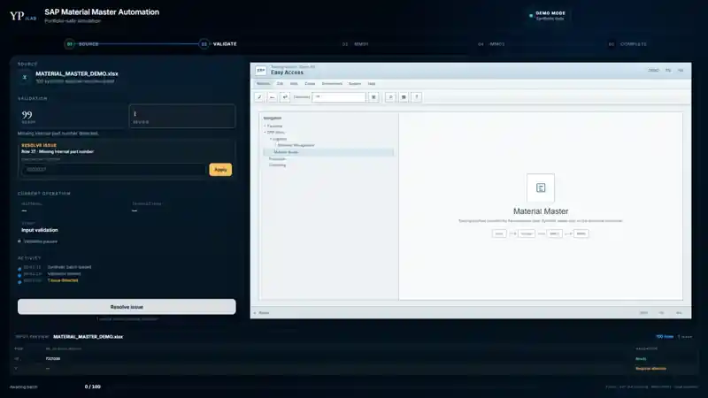
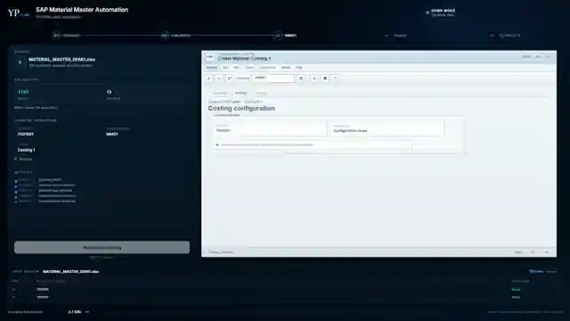
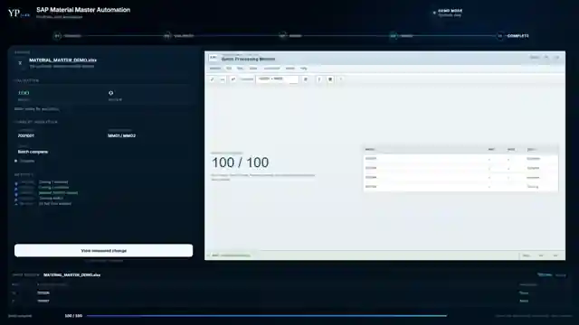
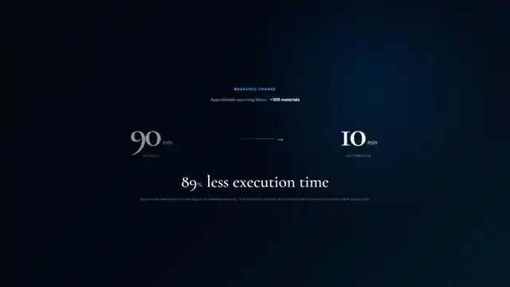

# SAP Material Master Automation

**Portfolio-safe simulation of a professional SAP material-master automation workflow.**  
A validated batch moves through an MM01/MM02-style process, surfaces incomplete input before execution, and then demonstrates the measured change from the original recurring workflow.

**Python · SAP GUI Scripting · ERP workflows · Input validation · Process automation**

> **Portfolio simulation:** this repository does not connect to SAP and contains no company credentials, production master data, internal URLs, or proprietary production source code. The material numbers and configuration values shown here are synthetic.

[**Live Demo →**](https://yospadilla.github.io/sap-material-master-automation-demo/)


## At a glance

| Recurring workflow | Manual | Automated | Approx. change |
| --- | ---: | ---: | ---: |
| ~100 materials | ~90 min | ~10 min | **~89% less execution time** |

The benchmark above is specific to the original professional workflow. It is not a general SAP performance claim.

## Why this project existed

Material-master work required a repetitive sequence of data entry and navigation in SAP GUI. The automation project focused on making that recurring work more consistent by:

- reading a batch of internal material numbers;
- validating required input before execution;
- automating a repeatable MM01 material-creation sequence;
- following with an MM02 costing update;
- surfacing records that require human attention instead of treating input as blindly valid;
- keeping a clear execution trail for review.

The portfolio demo recreates that logic safely without using a live SAP environment.

## Demo

Open the **[live portfolio demo](https://yospadilla.github.io/sap-material-master-automation-demo/)** to run the same sequence shown in this case study.

The repository includes two ways to experience the project:

- **Interactive mode** — step through load, validation, correction and execution manually.
- **Director mode** — play the complete portfolio sequence automatically for recording or presentation.

The included capture tooling can reproduce the same sequence at **1600×900**, take milestone screenshots and save a video without depending on the physical resolution of the computer running it.

The Director sequence is reproducible locally with the included Playwright capture tooling.

## Workflow

```text
Synthetic input batch
        │
        ▼
Input validation
        │
        ├── Missing required value → human review / correction
        │
        ▼
MM01-style creation flow
        │
        ├── Material definition
        ├── View selection
        ├── Organizational levels
        ├── Accounting
        └── Costing
        │
        ▼
Material created
        │
        ▼
MM02-style costing update
        │
        ▼
Batch processing
        │
        ▼
Measured change
```

## Validation before execution

One synthetic row is intentionally incomplete. The demo identifies it before the automation is allowed to proceed.



This is intentional: the project is meant to communicate **controlled automation**, not only scripted clicks.

## ERP workflow simulation

The right side of the interface is a purpose-built ERP training simulation. It uses familiar enterprise-software patterns while deliberately avoiding a pixel-perfect clone, SAP branding, production configuration or a real connection.



The left side represents the automation layer: source state, validation, current transaction, execution stage and activity history.

## Batch result

After the first material is shown in detail, the remaining records are accelerated for the portfolio demonstration.



## Measured change



For the original recurring professional workflow, a batch of approximately 100 materials was reduced from roughly **90 minutes of manual execution to about 10 minutes automated**.

## What is real vs. simulated

### Based on the professional project

- Python-driven SAP GUI automation.
- MM01/MM02 material-master workflow.
- Batch-oriented execution.
- Input validation and progressive exception handling.
- Approximate recurring benchmark of ~100 materials, ~90 minutes manual and ~10 minutes automated.

### Simulated for this repository

- All material identifiers.
- ERP screens and visual interface.
- Plant, material-type and valuation/configuration values shown in the demo.
- Timing of the on-screen Director sequence.
- The intentionally incomplete demonstration record.

## Architecture

```text
┌───────────────────────────────┐
│ Synthetic source data        │
│ JSON + XLSX                  │
└──────────────┬────────────────┘
               ▼
┌───────────────────────────────┐
│ Validation / state machine   │
│ Vanilla JavaScript           │
└──────────────┬────────────────┘
               ▼
┌───────────────────────────────┐
│ Automation Controller        │
│ orchestration + activity log │
└──────────────┬────────────────┘
               ▼
┌───────────────────────────────┐
│ ERP Simulation              │
│ MM01 → MM02 → batch result  │
└──────────────┬────────────────┘
               ▼
┌───────────────────────────────┐
│ Playwright capture tooling   │
│ screenshots + video         │
└───────────────────────────────┘
```

## Project structure

```text
.
├── index.html
├── styles/
│   ├── app.css
│   ├── erp.css
│   └── animations.css
├── src/
│   ├── app.js
│   ├── demo-data.js
│   └── state-machine.js
├── data/
│   ├── materials-demo.json
│   └── MATERIAL_MASTER_DEMO.xlsx
├── capture/
│   ├── server.mjs
│   ├── record-demo.mjs
│   └── capture-screenshots.mjs
├── docs/media/
├── START_DEMO.bat
├── RECORD_DEMO.bat
└── README.md
```

## Run locally

### Quick start on Windows

Double-click:

```text
START_DEMO.bat
```

### From a terminal

```bash
npm install
npm run serve
```

Then open:

```text
http://127.0.0.1:4173
```

## Director mode

Use **Run portfolio sequence** in the interface, or open:

```text
http://127.0.0.1:4173/?director=1
```

The sequence runs automatically from validation through the impact scene.

## Reproduce the recording

On Windows:

```text
RECORD_DEMO.bat
```

Or from a terminal:

```bash
npm install
npx playwright install chromium
npm run record
```

The recorder uses a virtual **1600×900** Chromium viewport and verifies that the full interface fits without scrolling before recording begins.

Generated assets are saved in `output/`.

If Playwright's FFmpeg download is interrupted by the network, run:

```text
NETWORK_RETRY_FFMPEG.bat
```

For screenshots only:

```text
RECORD_SCREENSHOTS_ONLY.bat
```

## GitHub Pages

The repository includes a GitHub Pages workflow in `.github/workflows/pages.yml`.

Expected public URL:

https://yospadilla.github.io/sap-material-master-automation-demo/

## Privacy and intellectual-property boundary

This repository is intentionally a **reconstruction for portfolio use**, not a publication of a company's internal implementation.

It does **not** include:

- production SAP access;
- company credentials;
- real material master data;
- internal server or client information;
- proprietary production source code;
- screenshots from a production SAP system.

The goal is to demonstrate the engineering approach, workflow understanding and automation design while respecting the boundary between professional experience and public portfolio material.

## Author

**Yoshio Padilla**

Computer Systems Engineering · Enterprise Technology · Business Process Automation · Data Analytics
