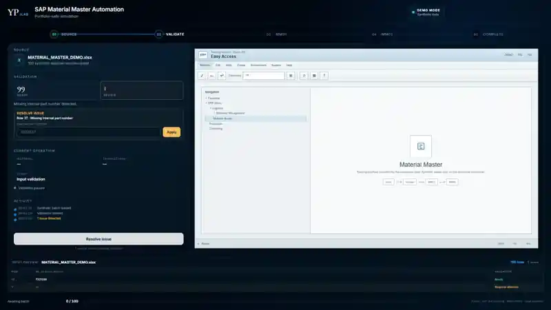
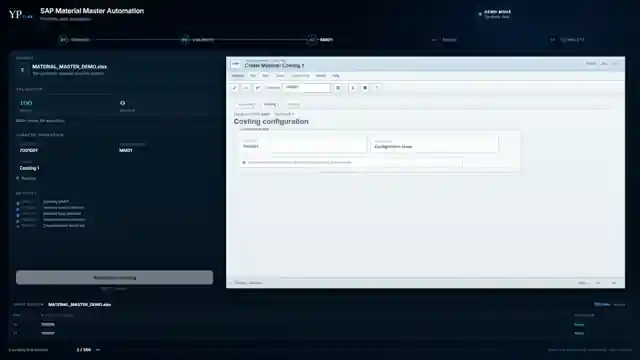
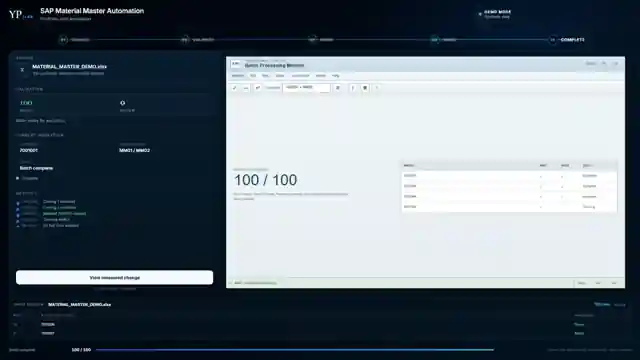

# SAP Material Master Automation

**Portfolio-safe reconstruction of a professional SAP material-master automation workflow.**  
A validated batch moves through an MM01/MM02-style process, surfaces incomplete input before execution, and demonstrates the measured change from the original recurring workflow.

**Professional workflow: Python · SAP GUI Scripting · SAP GUI · MM01/MM02 · Batch validation**  
**Public reconstruction: JavaScript · HTML · CSS · State machine · Synthetic JSON/XLSX data**

> **Portfolio reconstruction:** this repository does not connect to SAP and contains no company credentials, production master data, internal URLs, or proprietary production source code. The material numbers and configuration values shown here are synthetic.

[**Live Demo →**](https://yospadilla.github.io/sap-material-master-automation-demo/)


## At a glance

| Recurring workflow | Manual | Automated | Approx. change |
| --- | ---: | ---: | ---: |
| ~100 materials | ~90 min | ~10 min | **~89% less execution time** |

The benchmark above is specific to the original professional workflow. It is not a general SAP performance claim.

## Why this project existed

Material-master work required a repetitive sequence of data entry and navigation in SAP GUI. The professional automation focused on making that recurring work faster and more consistent by:

- reading a batch of internal material numbers;
- validating required input before execution;
- automating a repeatable MM01 material-creation sequence;
- following with an MM02 costing update;
- surfacing records that require human attention instead of treating input as blindly valid;
- keeping a clear execution trail for review.

The public reconstruction recreates that business logic safely without using a live SAP environment.

## Technology and automation approach

### Professional workflow

The original implementation was built around **Python + SAP GUI Scripting** and applied controlled automation to a recurring material-master process. The important engineering pattern was not simply automating clicks: input was checked before execution, exceptions remained visible, and the process followed a defined MM01 → MM02 sequence.

Core concepts represented by the professional workflow:

- **Python** for batch automation and execution logic;
- **SAP GUI Scripting** for controlled interaction with SAP GUI;
- **MM01 / MM02** material-master transactions;
- **batch input validation** before SAP execution;
- **exception handling** for incomplete or invalid records;
- **activity logging** and process traceability;
- **process measurement** against the prior manual workflow.

### Public reconstruction

The live portfolio version intentionally does **not** connect to SAP. It is a safe front-end reconstruction implemented with:

- **Vanilla JavaScript** for workflow/state logic;
- a **finite-state machine** for controlled progression through validation, MM01, MM02 and completion;
- **HTML + CSS** for the ERP-style training interface;
- **JSON / XLSX synthetic data** for the demonstration batch;
- a **guided workflow** that automatically walks through the same business sequence for presentation.

This separation keeps the professional SAP experience technically clear without publishing production access, source code or master data.

## Workflow

```text
Synthetic input batch
        │
        ▼
Input validation
        │
        ├── Missing required value → human review / correction
        │
        ▼
MM01-style creation flow
        │
        ├── Material definition
        ├── View selection
        ├── Organizational levels
        ├── Accounting
        └── Costing
        │
        ▼
Material created
        │
        ▼
MM02-style costing update
        │
        ▼
Batch processing
        │
        ▼
Measured change
```

## Validation before execution

One synthetic row is intentionally incomplete. The demo identifies it before the automation is allowed to proceed.



This is intentional: the project communicates **controlled automation**, not blind scripted execution.

## ERP workflow reconstruction

The right side of the interface is a purpose-built ERP training simulation. It uses familiar enterprise-software patterns while deliberately avoiding a pixel-perfect clone, SAP branding, production configuration or a real SAP connection.



The left side represents the workflow controller: source state, validation, current transaction, execution stage and activity history.

## Batch result

After the first material is shown in detail, the remaining synthetic records are accelerated to communicate the batch-oriented workflow.



## Measured change


For the original recurring professional workflow, a batch of approximately 100 materials was reduced from roughly **90 minutes of manual execution to about 10 minutes automated** — approximately **89% less execution time** for that recurring process.

## What is real vs. simulated

### Based on the professional project

- Python-driven SAP GUI automation.
- SAP GUI Scripting.
- MM01/MM02 material-master workflow.
- Batch-oriented execution.
- Input validation and progressive exception handling.
- Approximate recurring benchmark of ~100 materials, ~90 minutes manual and ~10 minutes automated.

### Simulated for this repository

- All material identifiers.
- ERP screens and visual interface.
- Plant, material-type and valuation/configuration values shown in the demo.
- Timing of the guided walkthrough.
- The intentionally incomplete demonstration record.
- The JavaScript interface used to reconstruct the professional workflow publicly.

## Architecture

```text
┌───────────────────────────────┐
│ Synthetic source data         │
│ JSON + XLSX                   │
└──────────────┬────────────────┘
               ▼
┌───────────────────────────────┐
│ Input validation              │
│ controlled exception handling │
└──────────────┬────────────────┘
               ▼
┌───────────────────────────────┐
│ Workflow state machine        │
│ JavaScript + activity log     │
└──────────────┬────────────────┘
               ▼
┌───────────────────────────────┐
│ ERP workflow reconstruction   │
│ MM01 → MM02 → batch result    │
└──────────────┬────────────────┘
               ▼
┌───────────────────────────────┐
│ Measured operational impact   │
│ ~90 min → ~10 min             │
└───────────────────────────────┘
```

## Project structure

```text
.
├── index.html
├── styles/
│   ├── app.css
│   ├── erp.css
│   └── animations.css
├── src/
│   ├── app.js
│   ├── demo-data.js
│   └── state-machine.js
├── data/
│   ├── materials-demo.json
│   └── MATERIAL_MASTER_DEMO.xlsx
├── docs/media/
├── server.mjs
├── START_DEMO.bat
└── README.md
```

## Run locally

### Quick start on Windows

Double-click:

```text
START_DEMO.bat
```

### With Node.js

```bash
npm install
npm run serve
```

Then open:

```text
http://127.0.0.1:4173
```

## Guided workflow

Use **Run guided workflow** in the interface, or open:

```text
http://127.0.0.1:4173/?guided=1
```

The sequence progresses automatically from validation through the measured-impact scene.

## GitHub Pages

Public URL:

https://yospadilla.github.io/sap-material-master-automation-demo/

## Privacy and intellectual-property boundary

This repository is intentionally a **reconstruction for portfolio use**, not a publication of a company's internal implementation.

It does **not** include:

- production SAP access;
- company credentials;
- real material master data;
- internal server or client information;
- proprietary production source code;
- screenshots from a production SAP system.

The goal is to demonstrate the engineering approach, workflow understanding and automation design while respecting the boundary between professional experience and public portfolio material.

## Author

**Yoshio Padilla**

Computer Systems Engineering · SAP · Business Process Automation · Data Analytics

[LinkedIn](https://www.linkedin.com/in/yoshio-p-889804291/)
